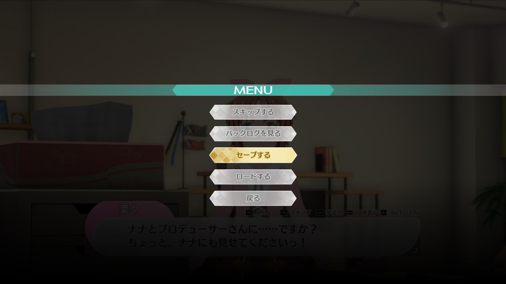
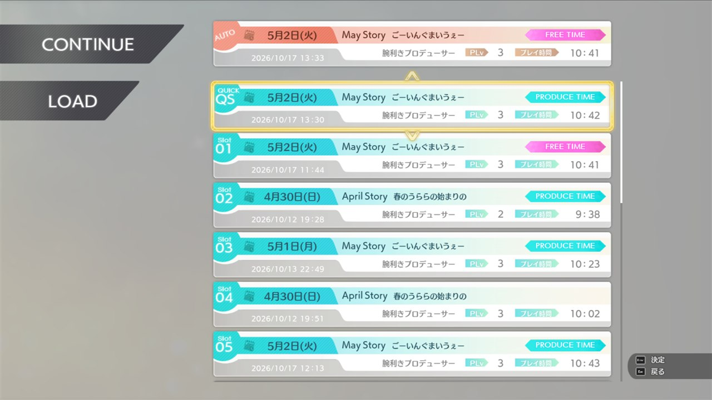
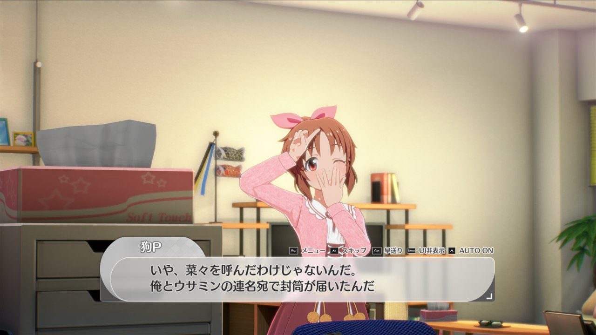
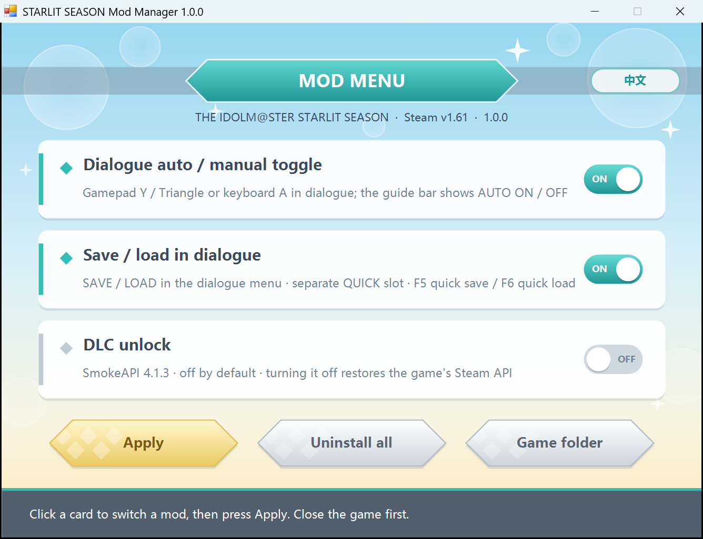

# Starlit Season Mod Pack

English | [中文](README_zh.md)

A small mod pack for THE IDOLM@STER STARLIT SEASON with a switch-board manager.

For **Windows / Steam version 1.61**.

| Mod | What it does |
| --- | --- |
| Dialogue auto / manual toggle | Press gamepad Y / Triangle or keyboard A in a dialogue to switch auto-advance; the state shows in the game's own guide bar. Maintained in [its own repository](https://github.com/AlphaBoom/starlit-season-text-auto-toggle). |
| Save / load enhancement | SAVE / LOAD in the dialogue menu, a separate QUICK save slot under AUTO, F5 quick save and F6 quick load. See [details](mods/DialogueMenu/README.md). |
| DLC unlock (off by default) | Uses [SmokeAPI](https://github.com/acidicoala/SmokeAPI) 4.1.3. Turn it on in the manager. |

## Features

**Save and load from the dialogue menu.** The game's dialogue menu (Esc / gamepad menu button) gets SAVE and LOAD
above 戻る (Back), opening the game's own save / load screens. A save made during a dialogue resumes from the
checkpoint the game takes when the dialogue starts.

**A separate QUICK slot.** QUICK sits right below AUTO, in the game's gold row style, and never overwrites AUTO or
slots 01–15. **F5** saves to QUICK and **F6** loads QUICK: in dialogues, and on the home and map screens wherever the
game's SYSTEM menu offers saving. QUICK also appears on the title screen's LOAD and the game's other save / load screens.

**Dialogue auto / manual toggle.** Keyboard A or gamepad Y / Triangle; the icon follows the device you use
(keyboard shown below).

**Mod manager.** Click a card to switch a mod, press Apply; "Uninstall all" restores the original game.
The button at the top right switches between English and Chinese.

## Install

1. **Close the game.** In Steam, right-click the game → **Manage → Browse local files** to open the game folder
   (the one containing `StarlitSeason.exe`).
2. Download `StarlitSeasonMods-<version>.zip` from [Releases](https://github.com/AlphaBoom/starlit-season-mods/releases/latest)
   and **extract it into that folder** (choose "replace" when asked).
3. Start the game from Steam. The dialogue toggle and save / load mods work right after extracting.

For DLC unlock, double-click **`StarlitMods.exe`**, turn on "DLC unlock" and press **Apply**.
The manager backs up the game's own Steam API file first.

## Switch mods / uninstall

- Open **`StarlitMods.exe`**, click the cards to switch mods, then press **Apply**. Changes apply the next time the game starts.
- **Uninstall all** removes the mods and the loader installed by this pack and restores the original Steam API.
  Saves are kept (the QUICK slot lives in the save file too). You can then delete `StarlitMods.exe` and the
  `StarlitModsData` folder.

To update, extract the new zip over the old one. If DLC unlock is on, open `StarlitMods.exe` once more and press **Apply**.

If Steam's "Verify integrity of game files" restores the Steam API, DLC unlock shows as off; turn it on and apply again.

For development, see the [build and release guide](docs/build.md).

---

Code in this repository is [MIT licensed](LICENSE). UE4SS is MIT licensed and SmokeAPI uses The Unlicense; their
license files ship in `StarlitModsData/licenses`. Game content belongs to its rights holders.
